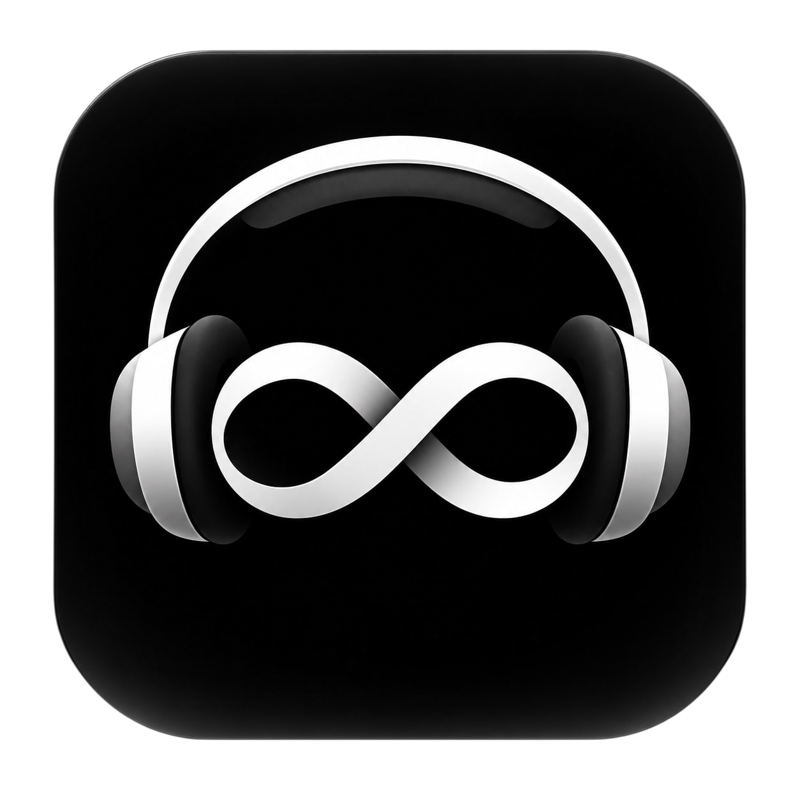
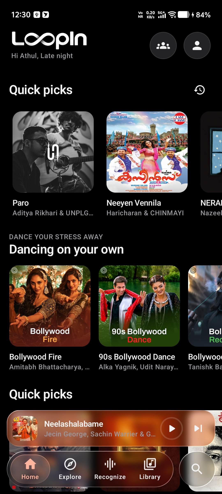
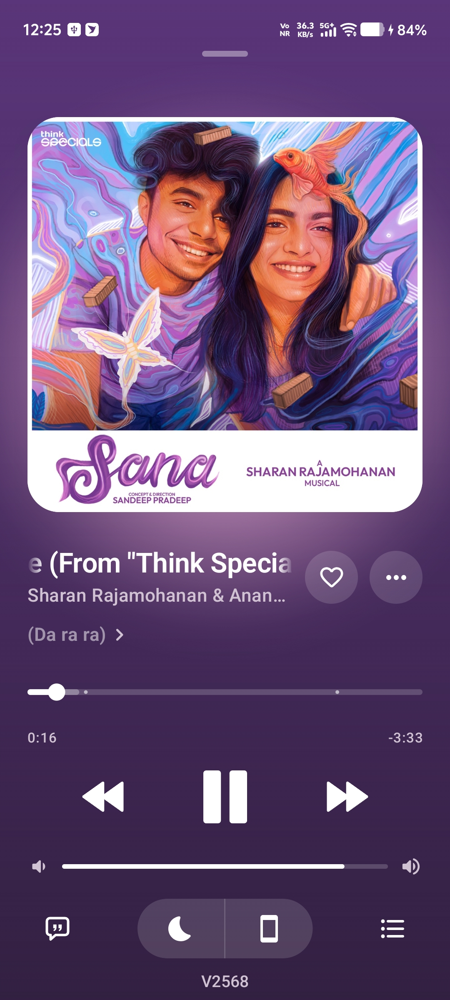
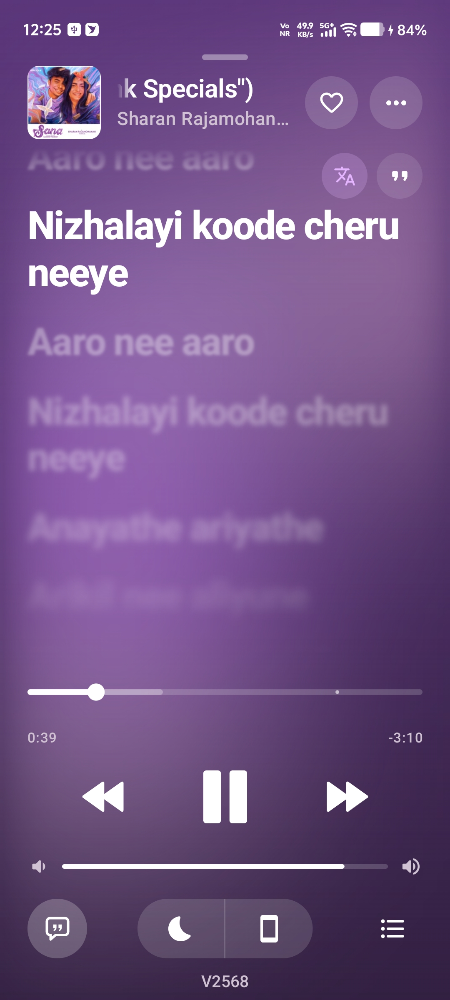
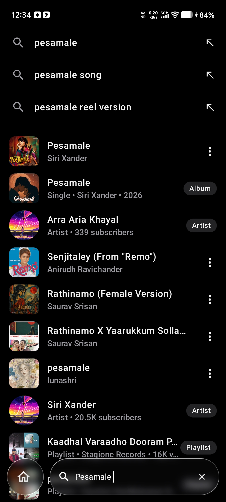
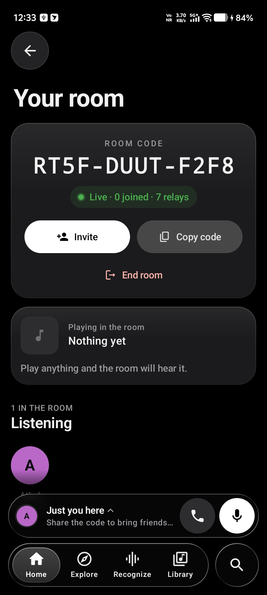
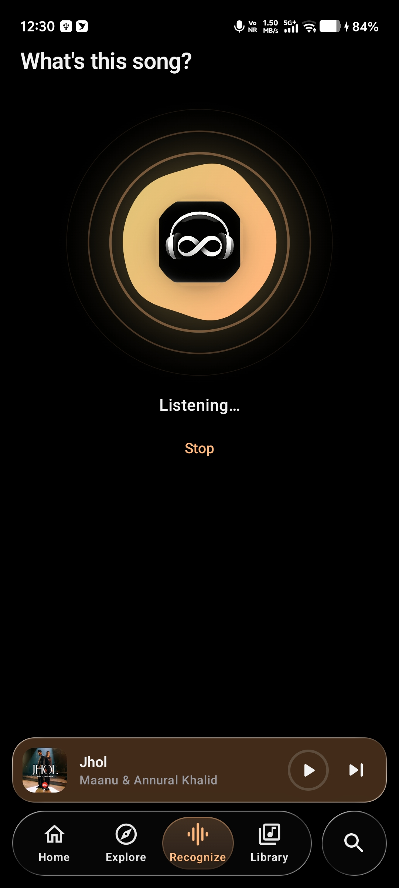

<p align="center">
  
</p>

<h1 align="center">LoopIn</h1>

<p align="center">
  <b>A clean, modern, ad-free music player for Android and iOS, built on YouTube Music.</b><br>
  Stream with synchronized lyrics, background playback, offline downloads, audiophile DSP, and signature Liquid Glass aesthetics.
</p>

<p align="center">
  <a href="https://github.com/Athulpk2005/LoopIn-Releases/releases/latest"><b>Download Latest Release</b></a>
  &nbsp;·&nbsp;
  <a href="#screenshots">Screenshots</a>
  &nbsp;·&nbsp;
  <a href="#features">Features</a>
  &nbsp;·&nbsp;
  <a href="#install">Install</a>
  &nbsp;·&nbsp;
  <a href="#building">Building</a>
</p>

<p align="center">
  <a href="https://github.com/Athulpk2005/LoopIn/actions/workflows/ci.yml"></a>
  <a href="https://github.com/Athulpk2005/LoopIn-Releases/releases"></a>
  
  
  
  
  <a href="LICENSE"></a>
</p>

---

## Overview

**LoopIn** is a native, high-performance music client designed for music lovers who value audio quality, privacy, and refined interface design. 

- **No ads, no subscriptions, no tracking.**
- **No API key or mandatory sign-in required.** Listen straight away, or sign in to your YouTube Music account to sync your personal likes and playlists.
- **Native performance:** Built from scratch with Kotlin, Jetpack Compose, and AndroidX Media3 for Android, and Swift and SwiftUI for iOS.
- **Discord Community:** Questions, ideas, or feedback? Join our [Discord](https://discord.gg/6udrCVh5n).

---

## Screenshots

<table>
  <tr>
    <td width="33%"></td>
    <td width="33%"></td>
    <td width="33%"></td>
  </tr>
  <tr>
    <td width="33%"></td>
    <td width="33%"></td>
    <td width="33%"></td>
  </tr>
</table>

---

## Features

### 🎧 Audiophile-Grade Playback Engine

- **Dual-Engine Auto-Switching:** InnerTubeX and LoopIn's native client stream engines switch automatically with zero playback interruption if a network error occurs.
- **Bit-Perfect USB Output (Android 14+):** Connect an external USB DAC to stream audio at its native sample rate and bit depth without Android mixer resampling, digital attenuation, or processing.
- **Lossless Audio Add-ons:** Connect optional BitChord-compatible HTTPS sources for bit-perfect FLAC streaming with auto-fallback to high-bitrate Opus/AAC.
- **Automatic Quality Upgrade:** Seamlessly upgrades streaming quality a few seconds in when a higher bitrate (such as 256 kbps Opus/AAC) becomes available without restarting the song.
- **Equal-Power Crossfade:** Smoothly blends between songs from 1 to 12 seconds with equal-power curves.
- **Smart Loudness Normalization:** Integrated YouTube loudness data ensures consistent volume across all tracks with a studio peak limiter to prevent clipping.
- **15-Band ISO Graphic Equalizer:** Features customizable presets, tone/balance sliders, sub-bass boost, stereo widening, and silence skipping.
- **AutoEq Headphone Correction:** Integrated parametric EQ profiles for 8,000+ headphones, calibrating your specific pair to the Harman target curve.
- **Spatial Audio & Remix Suite:**
  - **8D Audio & 3D Spatial Sound:** Dynamic binaural head-panning algorithm for headphones.
  - **Remix Controls:** Real-time speed and pitch shifting, Nightcore, and Slowed + Reverb presets.
- **Dolby Atmos & System Sound Effects:** Seamless integration with Samsung SoundAlive, Dirac, Dolby Atmos, and device system equalizers.
- **SponsorBlock Integration:** Automatically skips non-music video intros, music video dialog, and sponsored segments.

---

### 🪟 Signature Liquid Glass & Visual Experience

- **Liquid Glass Design System:** Real-time dynamic backdrop blur, refractive borders, and translucent glass materials on Android 13+ (gracefully adapted for older versions).
- **Dynamic Artwork-Reactive Themes:**
  - Dynamic palette generator tints the entire app, status bars, and ambient lighting directly from the playing album cover.
  - **White Accent / Monochrome Theme:** Clean, crisp modern white accent color available in settings alongside Material You dynamic color.
  - **AMOLED Pure Black Mode:** Optimized for OLED displays to maximize battery savings.
- **Moving Cover Art:** Album artwork subtly zooms, drifts, and breathes during playback for an organic vinyl-like feel.
- **7 Interchangeable Player Layouts:**
  1. **Classic:** Full-bleed album art, progress bar, and primary controls.
  2. **Vinyl:** Rotating turntable record player with dynamic vinyl grooves.
  3. **Cassette:** Vintage audio cassette with turning reels that wind as music plays.
  4. **Lyrics-First:** Compact cover art with prominent live scrolling lyrics.
  5. **Minimal:** Distraction-free cover and clean controls.
  6. **Halo:** Circular album art encircled by pulsating audio visualizer rings.
  7. **Polaroid:** Album cover styled as an instant film print that sways gently.
- **Wavy Ripple Seekbar:** Optional interactive audio waveform seekbar that ripples in real time to the music.
- **Dynamic Dock Navigation:** Floating glass pill dock with 3 transition modes: *Minimize* (contracts into an interactive circle), *Capsule* (condenses into a mini now-playing bar), or *Sink* (fades out during scrolling).
- **Haptic Feedback Engine:** Tactile, rhythmic feedback tuned for skips, volume ticks, like bursts, and button taps.
- **Opening Reveal Animation:** Zero-recomposition GPU-composited cinematic logo reveal on app launch with instant tap-to-skip.

---

### 🎤 Real-Time Synchronized Lyrics

- **Multi-Source Fallback System:** Aggregates lyrics from LRCLIB, KuGou, NetEase Cloud Music, Unison (Better Lyrics), and YouTube Music.
- **Word-by-Word Karaoke Sync:** Live syllable-level highlighting and smooth auto-scrolling with millisecond precision.
- **4 Animation Styles:** Fluid, Karaoke, Focus Zoom, and Minimal.
- **Lyrics Seek Preview:** Dragging the seekbar displays the exact lyric line sung at that timestamp over your finger.
- **Lyric Card Creator:** Select up to 5 favorite lines to export and share as high-resolution typography cards over blurred album artwork.
- **Offline Lyrics:** Lyrics are automatically saved with downloaded tracks for offline singing.

---

### 👥 Listen Together (Decentralized Social Rooms)

- **Synchronized Playback:** Listen with friends anywhere in the world in real time, with each device streaming directly for zero audio lag.
- **Decentralized Nostr Relays:** Runs completely peer-to-peer over Nostr relay networks. No account, no central server, and end-to-end encrypted with the room code.
- **Collaborative Queue & Live Chat:** Friends in the room can add songs, reorder the queue, vote, and chat.
- **Instant Access on Home:** Shortcut located right on the top bar next to your profile, complete with an active room status indicator.
- **Shareable Links:** Join via room code or direct deep link (`loopin://together/<code>`).

---

### 🔍 Discovery, Radio & Smart Recognition

- **Song Recognition ("What's That Song?"):** Listen through the microphone to identify music playing nearby using local audio fingerprinting and Shazam lookup with the animated LoopIn orb.
- **Algorithmic Daylist:** A dynamic mix that morphs throughout the day based on your listening habits and time of day (morning, afternoon, late night).
- **Personalized Daily Mixes:** Automatic daily mixes tailored to your top artists, genres, On Repeat, and Rediscover favorites.
- **50,000+ Live Radio Stations:** Free internet radio directory powered by Radio Browser with geolocation search for local FM/AM streams.
- **Multi-Platform Recommendation Engines:** Choose between YouTube Music radio, Spotify recommendations, or JioSaavn for autoplay and radio.
- **Full YouTube & Spotify Link Support:** Paste any YouTube or Spotify song/playlist/album link to play or import directly.

---

### 📥 Library, Offline & Sync

- **Offline Downloads:** Download individual songs, full albums, or entire playlists with high-speed parallel downloads and background sync.
- **YouTube Music Account Sync:** Sign in via an isolated WebView to sync your liked songs, subscriptions, and playlists securely.
- **Spotify Library Integration:** View your Spotify library inside LoopIn and export/import playlists via CSV or Exportify.
- **Subsonic Personal Server:** Stream FLAC and hi-res music from your self-hosted Navidrome, Gonic, Airsonic, or Nextcloud music server.
- **Smart Playlists:** Dynamic auto-updating playlists based on criteria (On Repeat, Top 100, Downloaded, Lossless, or Year).
- **LoopIn Wrapped & Replay:** Beautiful yearly listening recap story with animated statistics, charts, top artists, and exportable summary posters.
- **Android Auto & Widgets:** Full Android Auto integration for safe vehicle playback, plus rich home-screen widgets.
- **Seamless In-App Updates:** Built-in update checker alerts you to new GitHub releases with 1-tap in-app upgrades.
- **36 Supported Languages:** Complete native localization across all screens, dialogs, and notifications.

---

## Install

### Android

1. Download the latest APK from the [Releases page](https://github.com/Athulpk2005/LoopIn-Releases/releases/latest):
   - **`LoopIn-v1.0.1-arm64-v8a.apk`** *(Recommended)*: Fits 99% of modern Android devices.
   - **`LoopIn-v1.0.1-universal.apk`**: Universal fallback compatible with all architectures.
2. Open the downloaded file and tap **Install** (allow installation from unknown sources if prompted).
3. LoopIn automatically checks for new updates and can update itself directly from **Settings → About**.

*All releases include SHA-256 verification checksums in `SHA256SUMS.txt`.*

---

### iPhone and iPad

> **Requires iOS/iPadOS 16.0 or newer.**

LoopIn can be installed on iOS using standard sideloading methods:

1. Download the latest `LoopIn-iOS.ipa` from [Releases](https://github.com/Athulpk2005/LoopIn-Releases/releases/latest).
2. Install via your preferred tool:
   - **SideStore** *(Recommended)*: Install and auto-refresh over local Wi-Fi without needing a PC.
   - **AltStore**: Install using AltServer on PC or Mac with a free Apple ID.
   - **Sideloadly**: 1-click install from Windows or macOS.
   - **TrollStore**: Direct permanent install on supported iOS versions.
3. Enable **Settings → Privacy & Security → Developer Mode** and trust your developer certificate under **Settings → General → VPN & Device Management**.

---

## Building

### Android

Requirements: JDK 17+ and Android SDK 37 (targetSdk 36).

```bash
# Clone the repository
git clone https://github.com/Athulpk2005/LoopIn.git
cd LoopIn

# Build debug APK
./gradlew assembleDebug

# Build production release APKs
./gradlew assembleRelease

# Run unit tests
./gradlew testDebugUnitTest
```

### iOS

Requirements: macOS 14+, Xcode 15+, and [XcodeGen](https://github.com/yonaskolb/XcodeGen).

```bash
cd ios

# Generate Xcode project
brew install xcodegen
xcodegen generate

# Build Release IPA
xcodebuild -project Loopin.xcodeproj -scheme Loopin -configuration Release -sdk iphoneos build
```

---

## Project Layout

```text
app/src/main/java/com/loopin/
  ui/               Compose screens: Home, Explore, Search, Library, Player, Settings
core/
  src/main/cpp/     Native C++ audiophile audio pipeline, CMake build
  src/main/java/com/loopin/
    data/innertube/ InnerTube client, StreamResolver (engine switch), PoToken WebView
    data/           Account, downloads, library, history, lyrics, loudness, settings
    playback/       PlaybackService (ExoPlayer, cache, DSP, crossfade, sleep timer)
tv/
  src/main/java/com/loopin/tv/
                    Android TV app, remote receiver, and Leanback browsing
ios/
  LoopInCore/       Swift package: YouTube Music client, LRCLIB parser, models
  LoopIn/           SwiftUI native app: screens, AVPlayer engine, lockscreen, AirPlay
  project.yml       XcodeGen configuration file
docs/               Screenshots, documentation assets, and audio reviews
```

---

## Disclaimer

LoopIn is an independent open-source music player developed for educational and personal use. All album artwork, song titles, artist names, and trademarks belong to their respective copyright holders. LoopIn is not affiliated with, endorsed by, or connected to YouTube, Google, Spotify, or any associated entities.

---

## License

LoopIn is licensed under the **GNU General Public License v3.0**. See [LICENSE](LICENSE) for details. Third-party libraries and code licenses are documented in [THIRD_PARTY_NOTICES.md](THIRD_PARTY_NOTICES.md).
